# DWH-портфолио и кокпит Ostrovok

Монорепозиторий под вакансию **Middle+ DWH Engineer** (тревел-тех): восемь бизнес-кейсов с бэком и фронтом,
BFF-слой, который собирает их в один продукт, и продуктовый интерфейс «Кокпит« для коммерческой и аналитической
команды. Всё в стиле Островка, всё под тестами и линтерами.

## Что внутри

| Слой | Что это |
|---|---|
| `apps/web` | Портфолио: лендинг + 8 страниц кейсов (Next.js 16, App Router) |
| `apps/cockpit` | Продукт: «Кокпит Ostrovok» — 6 экранов для бизнеса |
| `services/*` | 8 DWH-сервисов на FastAPI + BFF, порты 8101–8109 |
| `services/*/dbt` | dbt-модели: staging → intermediate → mart, schema.yml с тестами |
| `services/*/dags` | DAG Airflow: расписание, ретраи, гейты по качеству |
| `packages/*` | Плагин ESLint с правилами стиля и дизайн-токены бренда |

### Восемь кейсов

| № | Проект | Бизнес-смысл | Стек | Порт |
|---|--------|--------------|------|------|
| 01 | Витрина бронирований | GMV, ADR, конверсия по каналам, схема «звезда» | SQL, dbt, Airflow, PostgreSQL | 8101 |
| 02 | Радар отмен | Скоринг риска отмены, ожидаемая потеря выручки | логистическая регрессия, ROC AUC, dbt | 8102 |
| 03 | Эластичность цен | Log-log МНК по котировкам, рекомендация тарифа | SQL, ClickHouse-стиль, dbt | 8103 |
| 04 | Прогноз спроса | Сезонная модель, бэктест MAPE, план загрузки | Airflow, dbt, Python | 8104 |
| 05 | Качество данных | SLO пайплайнов, свежесть витрин, dbt tests | Airflow, dbt, SQL | 8105 |
| 06 | Покрытие сети | Data Vault 2.0 по отелям и поставщикам, gap-анализ | hub/link/satellite, dbt, Trino | 8106 |
| 07 | Сверка комиссий | Федеративный запрос Trino, реестр недоплат | Trino, SQL, Airflow | 8107 |
| 08 | AI-копайлот аналитика | Вопрос на русском → метрика → SQL → ответ по данным | Python, каталог метрик, FastAPI | 8108 |
| — | **Кокпит (BFF)** | Единая сводка: деньги, риски, доверие к данным, алерты | BFF поверх 8 сервисов | 8109 |

Стек вакансии закрыт: SQL и оптимизация, MPP-подход, dbt, Trino, Git, Airflow, архитектура (3НФ / звезда / Data Vault),
AI в аналитике, Python + React/Next.js.

## Продукт: кокпит Ostrovok

Зачем BFF: бизнесу не нужны восемь API — нужен один экран. `services/cockpit_bff` собирает ответы всех сервисов
в один контракт (`/api/overview`, `/api/money`, `/api/trust`, `/api/pricing`, `/api/risks`, `/api/ask`), считает
алерты по порогам (SLO < 97%, расхождение комиссий > 100 000 ₽, дефицит покрытия) и применяет фильтры периода и города.

Экраны: **Сводка** (KPI, тренд GMV, алерты, статус 8 сервисов), **Направления** (сортировка, поиск, карточка города),
**Отмены** (риск по сроку брони, политика предоплаты, топ рисковых броней), **Партнёры и комиссии** (сверка + покрытие),
**Качество данных** (SLO, свежесть моделей, DQ-проверки), **Спросить копайлота** (NL → SQL → таблица).

## Как это выглядит

Портфолио: лендинг и страница кейса с живыми данными из API.

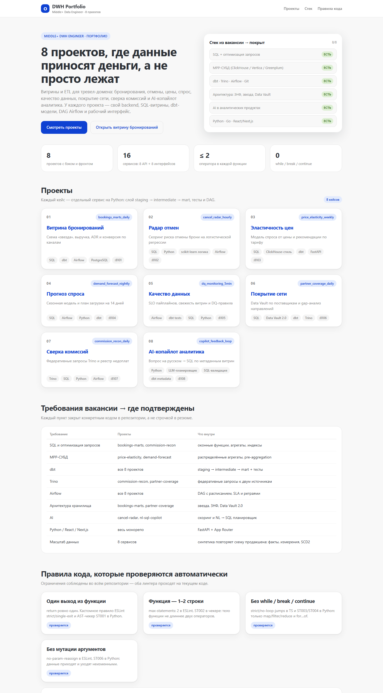

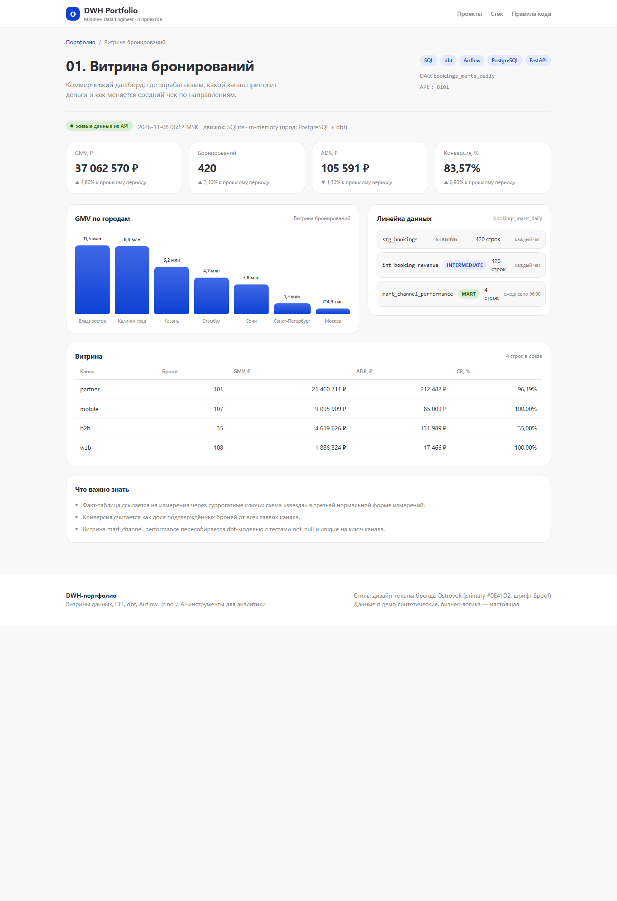

| Радар отмен | Качество данных | AI-копайлот |
|---|---|---|
| 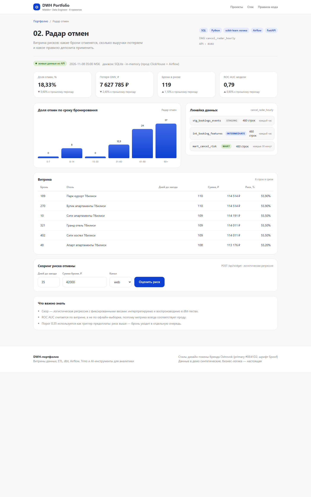 | 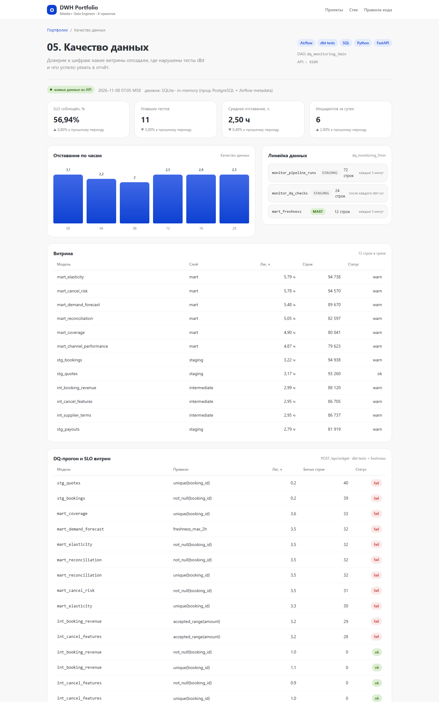 | 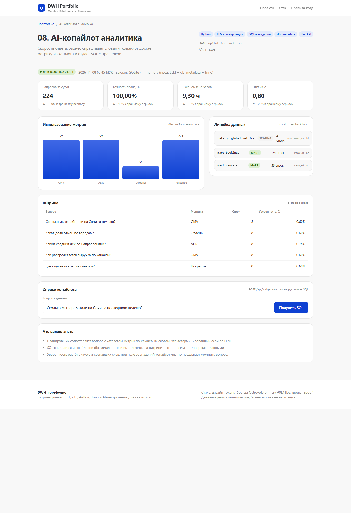 |

Кокпит: сводка по бизнесу и продуктовые экраны.

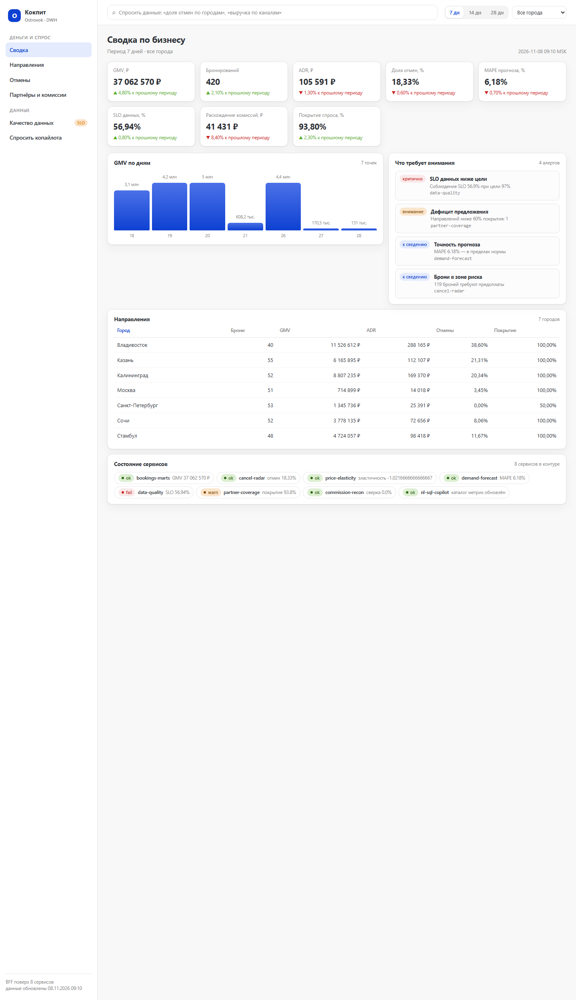

| Направления | Отмены |
|---|---|
| 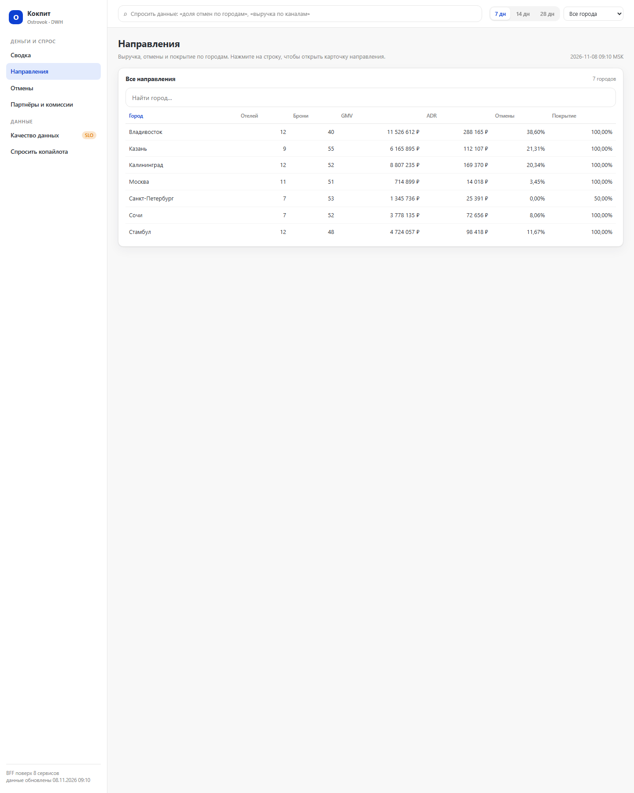 | 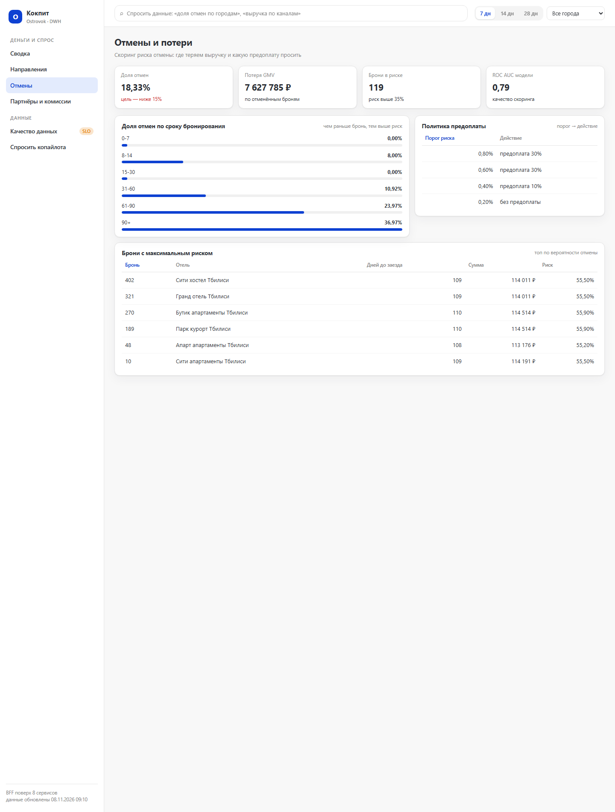 |

| Качество данных | Партнёры и комиссии | Копайлот |
|---|---|---|
| 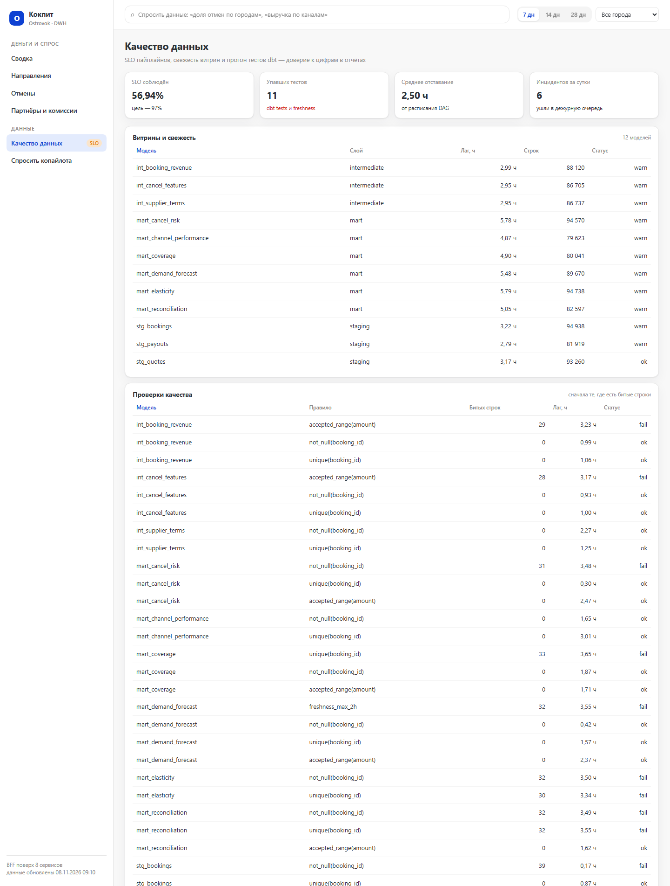 | 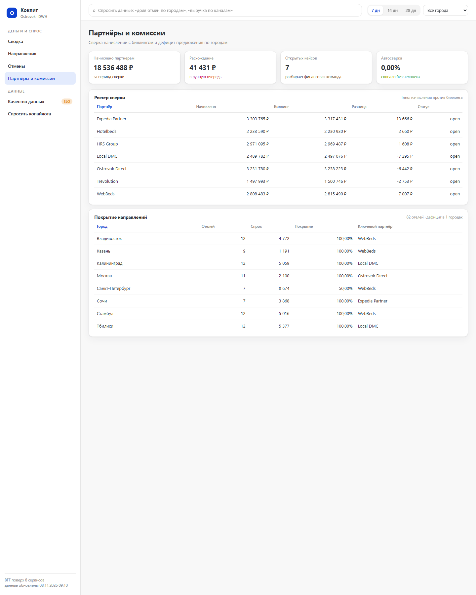 | 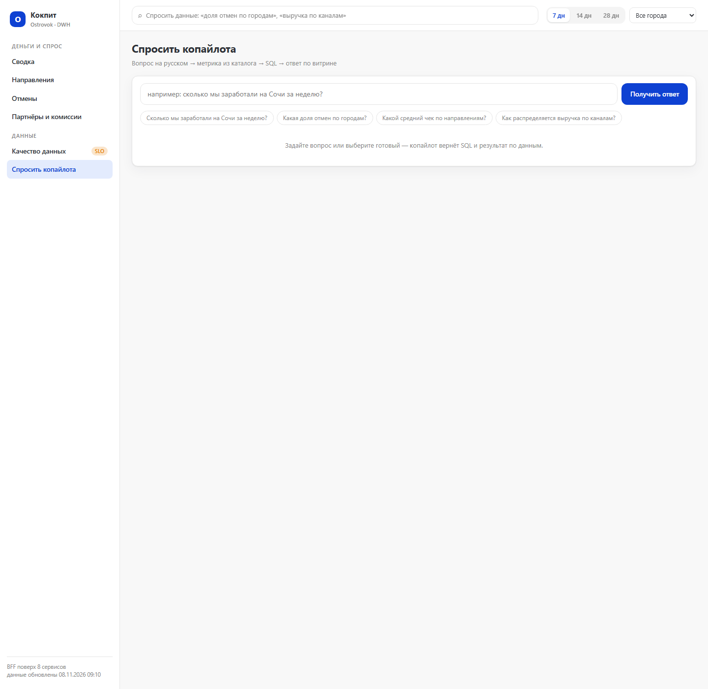 |

Пересборка снимков — `python tools/screenshots.py` (Chrome headless + поднятые сервисы).

## Стиль из сайта компании

Дизайн-токены сняты с CSS ostrovok.ru и лежат в `packages/design-tokens/tokens.json`:

- primary `#0E41D2`, hover `#0636C8`, secondary `#E3EBFD`
- текст `#2D3137`, вторичный `#868686`, границы `#E5E5E5`, фон `#F4F4F4` / `#F8F8F8`
- радиусы 4/6/8/12/20 px, кнопки и поля — 12 px, отступы 2–24 px
- шрифт бренда — **Spoof** (`font-family:Spoof` из CSS), с системным фолбэком
- статусные цвета: success `#53AF24`, warning `#E77D00`, alert `#CE2121`

## Правила кода (проверяются автоматически)

| Правило | TypeScript / JSX | Python |
|---|---|---|
| Один выход из функции (`return` ровно один) | правило `strict/single-exit` | `ST001` |
| Функция — 1–2 оператора | `max-statements: 2` | `ST002` |
| Без `while` / `break` / `continue` | правило `strict/no-loop-jumps` | `ST003` / `ST004` |
| Без мутации аргументов | `no-param-reassign` | `ST006` |

`return` считается выходом: две ветки с возвратом — уже нарушение, поэтому логика собрана из композиции
маленьких функций, тернарников и `map`/`filter`/`reduce`. Хуки чтения данных оформлены через `useLoader`/`useFetch`,
чтобы компонент укладывался в два оператора.

## Тесты: 603

| Набор | Тестов | Что проверяет |
|---|---|---|
| `services/tests/test_api_contract.py` | 270 | Контракт API всех 9 сервисов: 30 гарантий × 9 (KPI, графики, таблицы, линейка данных, CORS, детерминизм, 404, OpenAPI) |
| `services/tests/test_dbt_assets.py` | 100 | dbt-проекты: `ref`/`source`, `config`, сбалансированные скобки, документация в `schema.yml`, профиль |
| `services/tests/test_airflow_dags.py` | 72 | 8 DAG × 9 проверок: `dag_id`, расписание, теги, `catchup`, ретраи, ≥3 задачи |
| `services/tests/test_style_rules.py` | 66 | AST-чекер по всем python-файлам + проверка, что чекер ловит каждое нарушение |
| `services/tests/test_shared_layer.py` | 34 | Мини-хранилище, конверт ответа, детерминированные генераторы данных |
| `<сервис>/tests/` | 61 | Бизнес-логика кейсов и продуктовые срезы BFF |

```bash
npm run lint      # ESLint 10 + собственный плагин packages/eslint-plugin-strict
npm run check:py  # AST-чекер tools/check_style.py
npm test          # pytest: 603 теста
```

## Запуск

```bash
npm install          # зависимости монорепо (Next.js, ESLint, TypeScript)
npm run api          # 9 сервисов FastAPI на портах 8101–8109
npm run dev          # портфолио на http://localhost:3000
npm run dev:cockpit  # кокпит на http://localhost:3100
npm run build        # прод-сборка обоих приложений
```

Если backend не запущен, страницы портфолио показывают демо-данные с пометкой «демо-данные»;
как только сервис отвечает, бейдж переключается на «живые данные из API». Кокпит в этом случае честно сообщает,
что BFF не ответил, и подсказывает команду запуска.

## Структура

```
apps/web/                     Next.js 16: лендинг + 8 страниц кейсов
apps/cockpit/                 Next.js 16: продуктовый кокпит (6 экранов)
  components/                 KPI, тренд, грид с сортировкой, алерты, статус сервисов
  lib/                        типы, форматтеры, хук запросов, фильтры через контекст
packages/
  eslint-plugin-strict/       правила single-exit и no-loop-jumps
  design-tokens/              палитра и типографика бренда
services/
  _shared/                    хранилище in-memory, конверт ответа, генераторы, фабрика FastAPI, тестовая поддержка
  bookings_marts/             marts.py, app.py, dbt/, dags/, tests/
  ... ещё 7 сервисов по той же схеме
  cockpit_bff/                service.py (агрегация), app.py (маршруты), tests/
  tests/                      кросс-сервисные наборы: контракт, dbt, DAG, стиль, общий слой
docs/screenshots/             снимки интерфейса для README
tools/
  check_style.py              AST-чекер стиля Python
  dev_apis.py                 запуск всех девяти сервисов
  screenshots.py              пересборка снимков интерфейса
```

## Контракты API

Каждый DWH-сервис отдаёт одинаковый конверт — фронтенд рендерит его одним компонентом:

```
GET  /health          → { status, project, engine }
GET  /api/dashboard   → { project, title, subtitle, updatedAt, engine,
                          kpis[], charts[], table{columns,rows}, pipeline[], notes[], extra }
POST /api/widget      → ответ кейса (скоринг, симулятор цены, SQL копайлота, DQ-прогон)
```

BFF добавляет продуктовые срезы:

```
GET /api/overview?period=7&city=Сочи  → kpis, trend, destinations, alerts, health
GET /api/money | /api/trust | /api/pricing | /api/risks
GET /api/ask?q=доля+отмен+по+городам   → { sql, rows, answer, confidence, metric, table }
```

Swagger каждого сервиса — `http://127.0.0.1:8101/docs … :8109/docs`.

## Данные

Синтетика детерминированная (`services/_shared/seeding.py`, LCG): одинаковый сид даёт одинаковые цифры
в демо, в тестах и на скриншотах. Схемы повторяют продакшн-паттерны: факт + измерения, SCD2-сателлиты,
инкрементальные витрины, DQ-мониторинг. Сами витрины считаются SQL-запросами, бизнес-логика — в Python.
